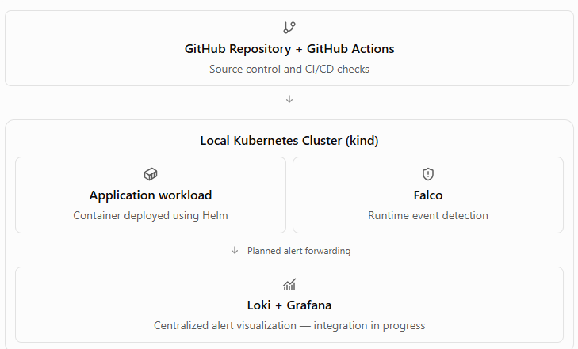

# Cloud-Native Workload Security Engineering Lab

**Kubernetes Security | Runtime Threat Detection | DevSecOps | Security Architecture**

A hcands-on security engineering laboratory for deploying, monitoring, and validating security controls for containerized Kubernetes workloads.

## 1. Executive Summary

This project examines how Kubernetes workload security controls can be implemented and validated throughout an application's lifecycle—from deployment and CI/CD checks to runtime threat detection and security observability.

The environment runs locally on an Ubuntu Linux virtual machine with Docker and Kubernetes (kind). Helm, Falco, and GitHub Actions support deployment and testing; Loki and Grafana form the basis of an observability integration that is still being developed.

**The objective is not simply to install security tools, but to verify what each control detects, retain evidence, and document architectural trade-offs and limitations.**

**Deployment scope:** This is a single-machine laboratory, not an AKS deployment or production cloud environment. The Kubernetes concepts and security patterns are relevant to managed services such as Azure Kubernetes Service (AKS), but managed-cloud integration has not been demonstrated here.

## 2. The Security Challenge

A successful deployment does not guarantee secure runtime behavior. A container may start normally and later execute unexpected processes or exhibit potentially suspicious activity.

A meaningful workload security design therefore needs complementary capabilities:

- **Deployment validation:** Inspect manifests and deployment configuration before and during release.
- **Runtime detection:** Observe processes and events in running containers.
- **Security observability:** Collect and investigate security-relevant telemetry.
- **Repeatability:** Run checks consistently and preserve supporting evidence.

**Architecture question:** How can a local Kubernetes environment combine repeatable deployment workflows with runtime monitoring and auditable validation of security controls?

## 3. Solution Architecture

| Capability | Technology | Role |
| --- | --- | --- |
| Local environment | Ubuntu Linux VM, Docker, kind | Reproducible local Kubernetes cluster |
| Application deployment | Helm | Manage and render Kubernetes deployment configurations |
| Runtime detection | Falco | Detect selected suspicious runtime events |
| CI/CD | GitHub Actions | Execute automated repository workflow checks |
| Event aggregation | Loki | Centralized logging component; alert integration in progress |
| Visualization | Grafana | Observability component; security dashboards in progress |
| Application/testing | Python, pytest | Application and test tooling where implemented |
| GitOps | Argo CD | Planned evaluation, not yet validated |

## Conceptual Security Architecture


[View the architecture diagram](docs/images/Architecture-and-Flows.png)

### Design considerations
pw
- **Defense in depth:** Deployment checks and runtime monitoring cover different activities.
- **Separation of responsibilities:** Deployment, detection, and analysis can be tested independently.
- **Least privilege:** Monitoring permissions and host access require deliberate review.
- **Evidence-based validation:** Installation or a successful CI run is not, by itself, proof that a security control works.
- **Operational trade-offs:** Detection coverage, false positives, overhead, and alert handling matter.

## 4. Validated Security Scenarios

### Scenario 1 — Falco detection of an interactive container shell

**Security objective:** Detect an interactive shell spawned inside a Kubernetes container.

**Why it matters:** Unexpected shell execution can warrant investigation, although an interactive shell is not inherently malicious.

**Test:** Run a shell inside a container and inspect Falco's runtime output.

**Observed result (17 November 2026):** Falco generated the alert:

```text
A shell was spawned in a container with an attached terminal
```

The captured event includes process and user attributes useful for investigation.

**Evidence:** [`evidence/03-falco-detection/terminal-shell-detection-2026-11-17.log`](evidence/03-falco-detection/terminal-shell-detection-2026-11-17.log)

**What this establishes:** Falco detected the *tested* interactive-shell execution scenario in the local environment.

**What it does not establish:** Malicious intent, complete detection coverage, automated containment, or an operational enterprise XDR/SIEM integration.

### Scenario 2 — Helm deployment configuration validation

**Security objective:** Support reproducible Kubernetes deployments and inspect rendered configuration.

**Validation:** Helm linting and template rendering have been exercised, including checks for the Grafana chart. Application Helm deployment records are also part of the laboratory work.

**What this establishes:** Chart rendering and validation workflows can run successfully.

**Limitation:** A chart that lints or renders successfully is not necessarily secure; hardening settings require separate checks.

### Scenario 3 — GitHub Actions workflow execution

**Security objective:** Automate repeatable repository and deployment checks.

**Observed result:** Successful GitHub Actions workflow runs have been recorded.

**What this establishes:** The configured CI workflow executes successfully.

**Limitation:** The security value of the pipeline depends on which tests and checks it actually performs; a green workflow is not proof of comprehensive CI/CD security.

## 5. Security Control Status

| Control or capability | Status | Evidence / next action |
| --- | --- | --- |
| Kubernetes application deployment | Implemented | Review Helm deployments and workload inspection |
| Falco interactive-shell detection | **Validated for tested scenario** | [Runtime alert log](evidence/03-falco-detection/terminal-shell-detection-2026-11-17.log) |
| Helm lint and template rendering | **Validated** | Document command results and configuration |
| GitHub Actions CI | **Operational** | Link successful workflow run and identify checks performed |
| Kubernetes workload hardening | In progress | Define settings and verify them with explicit tests |
| Falco alert forwarding into Loki | In progress | Demonstrate end-to-end ingestion and retrieval |
| Grafana security dashboards | In progress | Verify visualization of collected security events |
| Argo CD / GitOps | Planned | Define a reproducible GitOps scenario |

**Validation criterion:** A control is marked validated only when a specified test produces observable evidence supporting a defined objective.

## 6. Evidence and Documentation

- [`docs/`](docs/) — architecture, installation steps, configuration decisions, and test documentation.
- [`evidence/`](evidence/) — command output, runtime logs, screenshots, and other test artifacts, where available.
- [`docs/images/Architecture-and-Flows.png`](docs/images/Architecture-and-Flows.png) — architecture illustration.

A useful security test record states the **objective**, **configuration**, **procedure**, **expected outcome**, **observed outcome**, **evidence**, and **limitations**.

## 7. Architecture Decisions and Trade-offs

### Falco for runtime visibility

- **Problem:** Deployment-time checks do not reveal process activity after a container starts.
- **Approach:** Evaluate Falco's rule-based runtime monitoring in the local Kubernetes cluster.
- **Evidence:** Detection of an interactive shell in a container.
- **Trade-offs:** Runtime monitoring permissions, kernel/event collection compatibility, performance overhead, and false positives.
- **Boundary:** Detecting an event is not the same as triaging or containing an incident.

### Local kind cluster rather than a managed Kubernetes service

- **Purpose:** Provide a reproducible, low-cost environment for testing Kubernetes deployment and runtime controls.
- **Benefit:** Experiments can be run without provisioning paid public cloud resources.
- **Trade-off:** This environment does not validate AKS-specific identity, networking, managed control-plane, cloud logging, or enterprise availability controls.

### Centralized telemetry as a separate capability

- **Purpose:** Make relevant runtime events easier to search and review beyond individual pod logs.
- **Approach:** Evaluate Loki and Grafana integration.
- **Current boundary:** Installation and chart validation should not be confused with demonstrated end-to-end Falco alert delivery, querying, and dashboard visualization.

## 8. Scope and Limitations

This is a **local, single-machine security engineering laboratory**, not a production-ready security monitoring platform.

It does not claim:

- Production high availability or multi-cluster scale.
- Deployed public cloud infrastructure or managed AKS security validation.
- Enterprise EDR/XDR or SIEM product integration.
- Comprehensive detection effectiveness or incident response automation.
- Completed Argo CD/GitOps integration.

## 9. Next Steps

1. **Expand Falco validation:** Test additional relevant runtime scenarios, document expected versus observed alerts, and assess false positives.
2. **Complete observability integration:** Forward selected Falco events to Loki, query them, and visualize them in Grafana with retained evidence.
3. **Validate workload hardening:** Test selected Kubernetes security contexts, least-privilege permissions, and other workload controls.
4. **Strengthen CI evidence:** Link successful runs to the exact tests and checks they execute; add security-specific checks where useful.
5. **Evaluate GitOps:** Introduce Argo CD only after defining a concrete deployment scenario and success criteria.

---

*This repository documents practical security engineering work and architecture reasoning. Claims are intentionally limited to the scenarios and integrations actually tested.*
