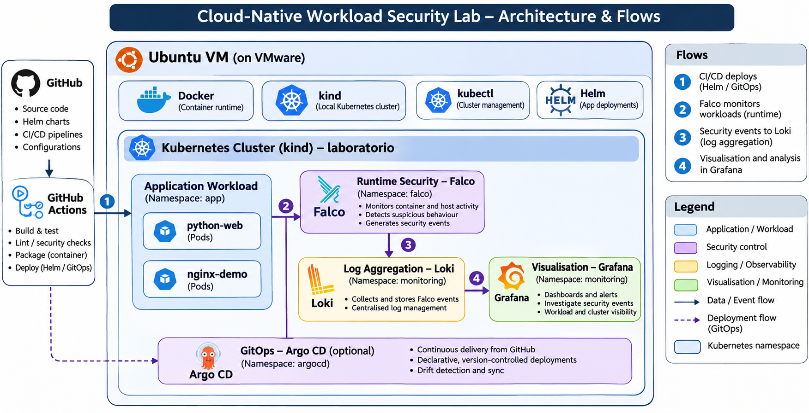

# Architecture – Cloud-Native Workload Security Lab

## Architecture Overview

This laboratory implements a local Kubernetes environment for workload security engineering, runtime threat detection, and security observability.

## Architecture Diagram

The diagram illustrates the relationship between:

- GitHub Actions for CI/CD automation
- Docker and kind for containerized Kubernetes workloads
- Helm for Kubernetes deployments
- Falco for runtime threat detection
- Loki for centralized log aggregation
- Grafana for security observability
- Argo CD for planned GitOps integration